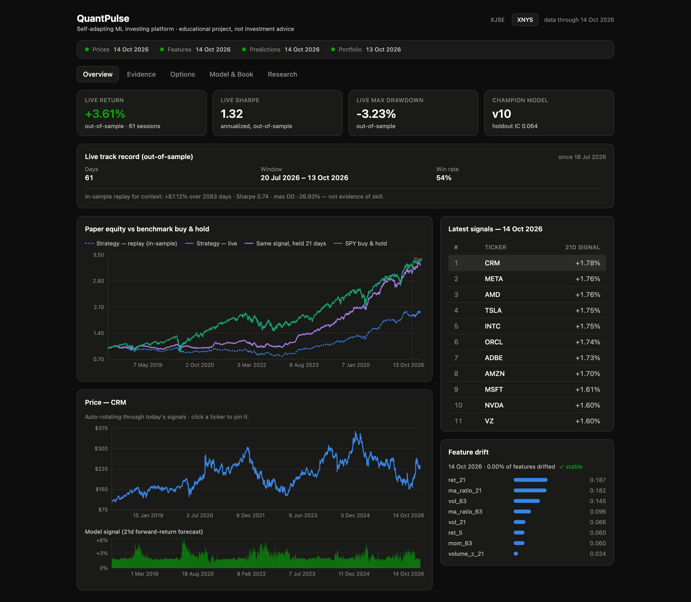
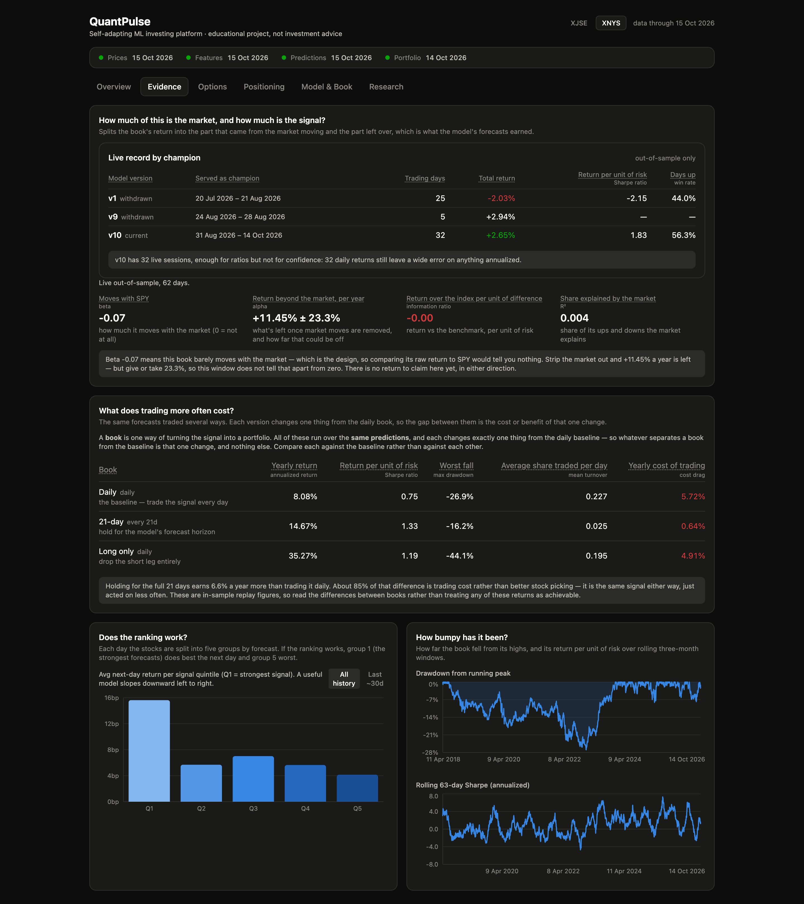
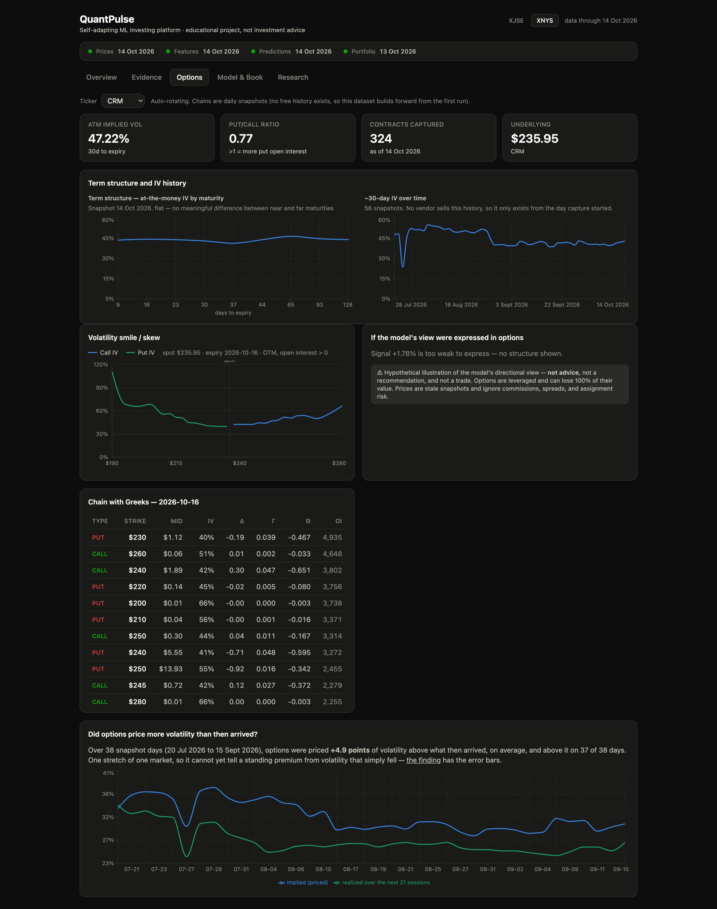
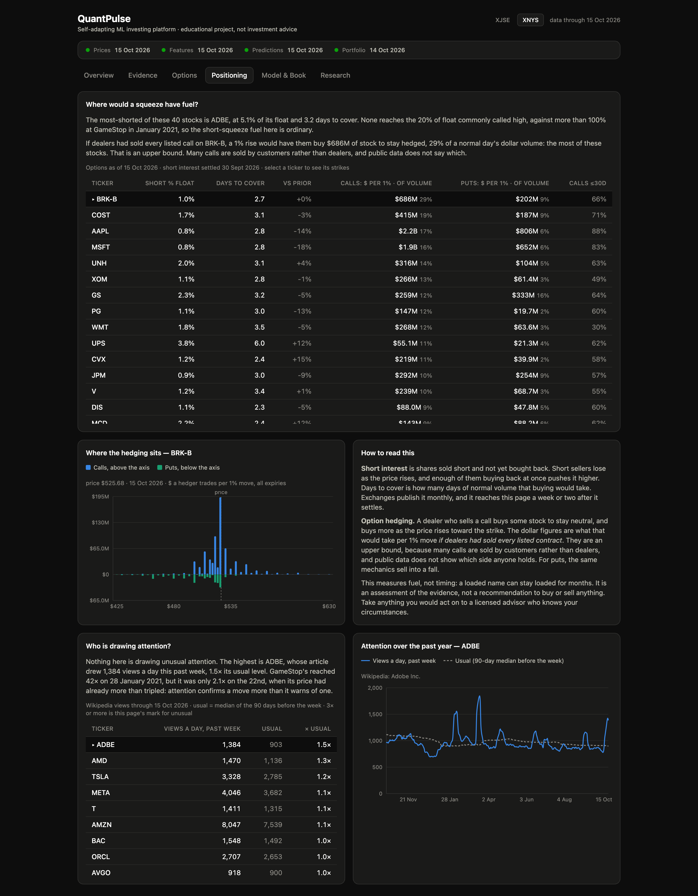
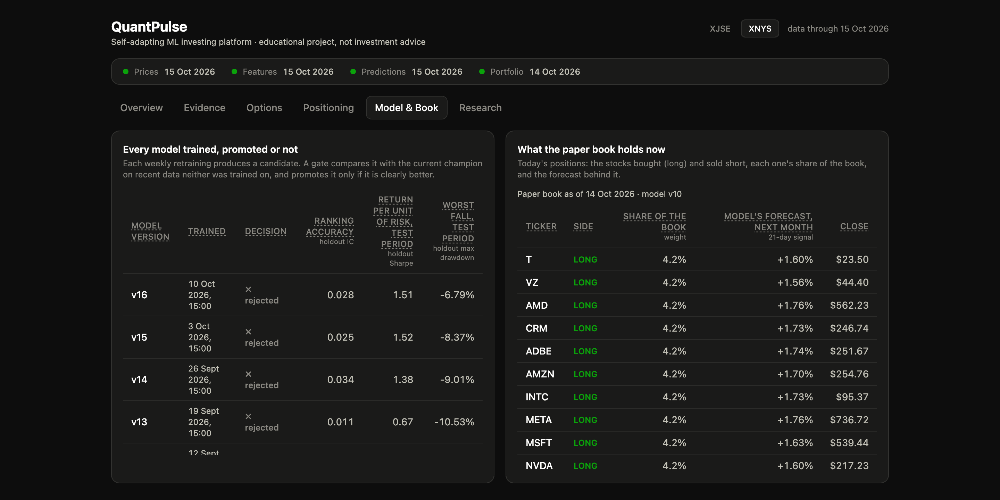
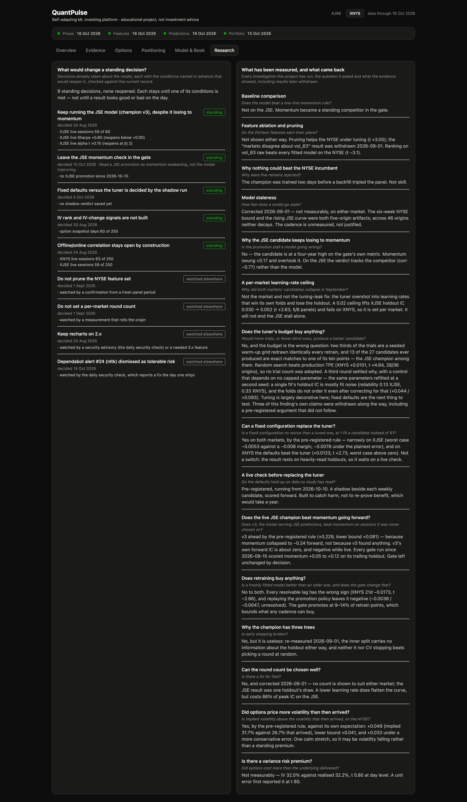
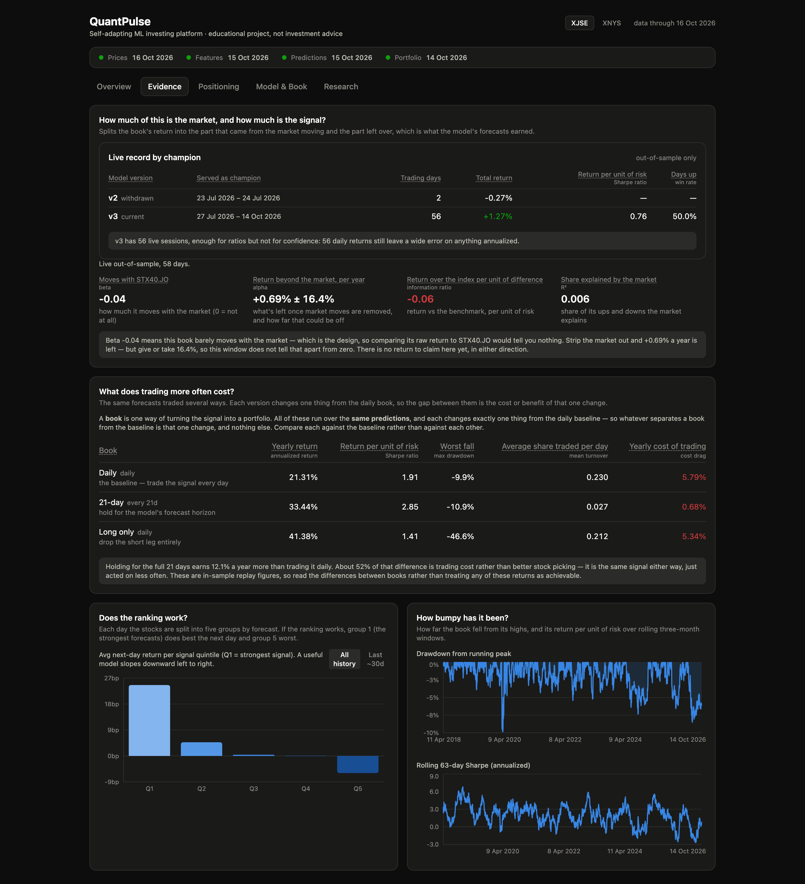
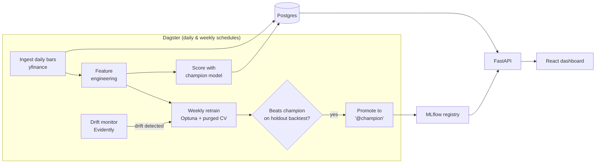

# QuantPulse

[](https://github.com/enkay-pixel/quantpulse/actions/workflows/ci.yml)
[](LICENSE)
[](pyproject.toml)
[](web/package.json)

A local-first MLOps platform for a **self-adapting ML investing model**, running **two markets —
NYSE and the JSE** side by side. Fully free, fully open-source, runs on one machine via Docker:
automated per-market data pipelines, scheduled retraining with champion/challenger promotion, drift
monitoring, a serving API, and a live dashboard with a market switcher.

> **Disclaimer**: educational engineering project. Nothing here is investment advice, and the
model's signals are research output in a sandbox — not trade recommendations.

## The live record

The only numbers here worth judging. Each market's live phase starts at its first champion
promotion; everything before that is an in-sample replay, kept separate on purpose.

| | NYSE (XNYS) | JSE (XJSE) |
|---|---|---|
| Live sessions | 62 (2026-07-20 to 2026-10-14) | 58 (2026-07-23 to 2026-10-14) |
| Total return | **+3.52%** | **+1.00%** |
| Sharpe | **+1.28** | **+0.59** |
| Max drawdown | −3.23% | −2.23% |
| Alpha (annualized) | +11.5% ± 23.3% | +0.7% ± 16.4% |
| Alpha t-statistic | **+0.49** | **+0.04** |
| Information ratio | 0.00 | −0.06 |
| Beta / R² | −0.07 / 0.004 | −0.04 / 0.006 |
| Win rate | 53.2% | 48.3% |

**Neither market has produced a result yet.** After three months live, both books are up, the
NYSE by 3.5% and the JSE by 1.0%, and neither is distinguishable from zero. Each alpha's standard
error is larger than the estimate: t of +0.49 and +0.04, against the ~2 that would separate
either from noise. On the JSE the champion's own forward skill is about zero
([scored against momentum](docs/findings/champion-vs-momentum.md)), and the standing decision to
keep running it comes up for review at 60 live sessions, around 2026-10-20.

An earlier version of this table, a month in, quoted a −22.6% NYSE alpha and argued "the sign is
the sign". Two months later the same alpha is positive. A sign is only a sign once it clears its
own error bar, and neither has. The annualized figures are a few percent of total return scaled
up to a year, not a rate anything has sustained.

Beta −0.07 and −0.04, with R² below 0.01, confirm both books are genuinely market-neutral, so
whatever these returns are, they are not disguised market exposure. The information ratio sits
near zero on both markets even though both made money: it is benchmark-relative and not
beta-adjusted, so a market-neutral book that sits out a rising index scores badly on it by
construction. Alpha and the information ratio answer different questions and are expected to
disagree here.

Ratios stay withheld below 20 sessions, because a handful of days annualizes into a
confident-looking number that is pure noise. The floor is necessary and not sufficient, which is
what the standard error column is for: clearing 20 days does not make an estimate mean anything,
and at 60 it still does not here.

The replay figures below are in-sample throughout. They describe a fit, not a forecast.

**Full documentation: [docs/](docs/README.md)** — roadmap, runbook, architecture,
the incident log, and the ADRs.



<details>
<summary><b>More screenshots</b> — Evidence, Options, Positioning, Model &amp; Book, and Research tabs</summary>

## Evidence — does the model actually have skill?



The CAPM decomposition is what makes the record readable: **a low beta and near-zero R²
confirm the book is genuinely market-neutral**, so comparing its raw return to SPY was never
the right test. The screenshots (taken 2026-10-15) show the live phase — 61 sessions out of
sample on the NYSE — where alpha's error band still spans zero, and the panel says so rather
than leaving the headline number to speak. The same decomposition for both markets is in the
table at the top of this page.

Below it, the two-book panel shows what rebalancing frequency actually costs, then signal
quintiles slope the right way (Q1 highest → Q5 lowest: real ranking skill, modest in size)
alongside drawdown and rolling Sharpe.

## Options — implied volatility, Greeks, and a hypothetical expression of the signal



The volatility smile is built from **out-of-the-money contracts with open interest only** —
deep in-the-money options barely trade, so their quoted IV is stale noise that would
otherwise spike both wings past 150%. The right-hand card translates the model's
directional view into a defined-risk spread, clearly labelled as illustration, never advice.
At the bottom, implied volatility runs beside the volatility that then arrived over the next 21
sessions — the [forward variance risk premium](docs/findings/forward-variance-risk-premium.md),
which a day joins only once its window has closed.

## Positioning — where a squeeze would have fuel



The research branch's first page ([ADR 0007](docs/adr/0007-research-branch-evidence-not-instructions.md)),
built on the two mechanics behind GameStop in January 2021. For each name with option chains it
shows the short interest, meaning shares sold short and not yet bought back. Beside that is the
stock dealers would have to buy per 1% rise if they had sold every listed call. On 2026-10-16 the
most-shorted of the 40 stocks was ADBE, at 5.1% of its float; GameStop's was above 100% then. The
strike chart shows where a name's hedging exposure sits against its price. Below that, for both
markets, is **attention**: each stock's daily Wikipedia views against its usual level. That is the
one research measure the JSE has free. GameStop's reached 42× its usual on 28 January 2021, but
only 2.1× on the 22nd, when its price had already tripled. The page measures fuel and attention,
not timing, and it assesses the evidence rather than advising on it.

## Model &amp; Book — every champion/challenger decision, and the current paper positions



## Research — what has been measured, and what would change a decision



Every investigation's question and outcome, read from the [findings index](docs/findings/README.md)
itself, withdrawn claims included. Beside them, each **standing decision** with the conditions
named in advance that would reopen it — so many live sessions, a Sharpe turning negative, a
promotion — evaluated on the current record by the same code as the weekday job that notifies
when one fires.

## The JSE — the same evidence layer, a different market



Switching to XJSE re-scopes everything: **beta is measured against STX40.JO** (not SPY —
comparing a JSE book to the S&P would measure the rand, not the strategy), the Options tab
is gone (no free JSE chain data), and the numbers are the JSE champion's. Its in-sample
replay looked strong — alpha +16%, IR 0.42, all three books positive — but live, over 57
sessions to 2026-10-13, its alpha is +1.45% ± 16.6% a year (the current champion is up 1.4%
over its 55): nothing it could claim in either direction.

There is a sharper caveat than that. `quantpulse baseline` scores every champion against
simple rules on the same holdout, and on the JSE **a plain 63-day momentum rule beats the
champion on every metric** — higher IC, higher Sharpe, half the drawdown, with no parameters
and no fitting. So these JSE figures may be measuring momentum rather than the model, and
[scored forward](docs/findings/champion-vs-momentum.md) the champion shows no skill of its own. On the
NYSE the champion wins decisively against the same baselines. That comparison is now a gate:
no model is promoted on either market without beating the rule first.

</details>

## What it does



- **Two markets, one platform** — NYSE and the JSE run side by side. `exchange` is a first-class
  dimension: per-market calendars and post-close schedules (in each market's timezone),
  cross-sectional features ranked *within* a market, one champion per market, and a dashboard
  switcher. Cross-sectional ranking that mixed Naspers with Apple would be noise, so it never does.
- **Ingestion** — daily OHLCV bars for a configurable multi-market universe
  ([configs/universe.yaml](configs/universe.yaml)), with retries, rate-limit respect, vendor
  unit-glitch repair (Yahoo occasionally reports JSE prices in Rand not cents), and data-quality
  checks as Dagster asset checks.
- **Self-adapting model** — LightGBM forward-return model per market, retrained weekly *and*
  whenever feature drift is detected; a challenger only replaces the champion if it wins on an
  out-of-sample backtest, and a first champion must clear a Sharpe floor (no champion beats a model
  that lost money out-of-sample).
- **Transforms** — a dbt project ([transform/](transform/)) builds staging views and analytics marts
  (daily returns, signal-quintile performance, portfolio drawdown, CAPM decomposition) per market
  with dbt tests, integrated into the Dagster asset graph via `dagster-dbt`. Small-sample ratios are
  nulled at source, so no consumer sees an annualized Sharpe off three days.
- **Options analytics** — daily live option-chain snapshots (free via yfinance) enriched with
  Black-Scholes Greeks, surfaced as an implied-volatility smile/skew, put/call ratio, and a chain
  browser. Because no free *historical* chain data exists, the pipeline **builds its own options
  history forward** from the first run. A clearly-disclaimered panel also illustrates how the
  model's directional view *would* translate into a defined-risk spread — an illustration, never
  advice.
- **Measured honestly** — a CAPM decomposition splits the return into the part that is just the
  market moving (beta) and the part that isn't (alpha), reported alongside the information ratio,
  because comparing raw return to SPY says nothing about a portfolio built to be market-neutral. The
  dashboard writes the verdict out in plain English — including when alpha and the information ratio
  point opposite ways, rather than quoting whichever one flatters, and it labels in-sample figures
  as a description of the fit rather than evidence of skill.
- **Fails loudly, catches up by itself** — a run-failure sensor logs every failure (served at
  `/alerts`, plus a desktop notification) and a catch-up sensor re-requests any trading day the
  schedule slept through, and fills the tickers a partial day is missing, so a laptop that sleeps
  doesn't silently cost you irreplaceable history.
- **Honest cost modelling** — the backtest charges commission, slippage, and an annualized
  short-borrow fee against *measured* position churn, and `quantpulse sensitivity` sweeps both to
  report a *range* of outcomes plus the breakeven trading cost, rather than a single flattering
  number.
- **Three books, one variable each** — the same predictions run as three portfolios (*books*), each
  changing exactly one thing from a shared baseline so the difference is attributable: `daily`
  (baseline), `horizon` (held 21 days — isolates trading cost, and **85% of the 6.6-point gap on
  NYSE is cost, not better picks**), and `long_only` (no short leg — isolates what the short
  contributes, and is executable where scrip lending is thin). Compare each to the baseline, never
  to each other.
- **Evidence, not vibes** — the dashboard separates the in-sample replay from the **live
  out-of-sample track record**, benchmarks each market against its own index (SPY / STX40.JO),
  charts signal-quintile forward returns and rolling risk, and shows every champion/challenger
  decision — including reversals — the self-adapting loop ever made.
- **Serving** — FastAPI exposes predictions, portfolio equity curve, model metadata, and drift status.
- **Dashboard** — React app with templated charts that refresh from the API.

## Quickstart

```bash
cp .env.example .env          # adjust if you like
make up                       # start the Docker stack
make install                  # install package + dev tools into your venv
make test                     # run unit tests
```

### First run (seed the platform)

On a fresh database, one command migrates the schema, syncs the universe, backfills
history, computes features, trains + promotes the first champion, and scores the
signal trail for the dashboard:

```bash
make bootstrap
```

From then on the Dagster schedules keep everything current whenever the stack is up: each
market ingests after its own close in its own timezone, processing runs once after the
latest close, and retraining runs weekly plus on detected drift. The dashboard's
pre-champion equity history is an **in-sample replay** to seed the charts — the live track
record accrues from the first scheduled runs onward. Switch markets on the dashboard with
the XNYS / XJSE toggle (also in the URL: `?market=XJSE`).

| UI | URL |
|---|---|
| Dagster | <http://localhost:3000> |
| MLflow | <http://localhost:5001> (5000 is taken by macOS AirPlay) |
| API docs | <http://localhost:8000/docs> |
| Dashboard | <http://localhost:8080> |

Postgres is exposed on `localhost:5432` (DBeaver-friendly; credentials in your `.env`).

## Project status

- [x] M0 — Project scaffold, tooling, CI
- [x] M1 — Data platform (schema, ingestion, quality checks)
- [x] M2 — ML core (features, purged CV, training, backtest, promotion)
- [x] M3 — Dagster orchestration + full Docker stack
- [x] M4 — Serving API
- [x] M5 — React dashboard
- [x] M6 — Docs polish & first release
- [x] M7 — dbt transform layer (staging + marts, tests in CI, dagster-dbt lineage)
- [x] M8 — Evidence dashboard (live vs replay track record, SPY benchmark, quintile & risk charts,
  model audit trail)
- [x] M9 — Options layer (chain snapshots + Greeks, IV surface & put/call marts, Options tab,
  hypothetical signal→spread translation)
- [x] M10 — Rigor & reliability (CAPM alpha/beta, failure alerts, missed-day catch-up)
- [x] M11 — Multi-market (exchange as a first-class dimension, JSE added, market switcher, three
  paper books, resource-headroom check)

## Development

```bash
make fmt        # format + autofix
make lint       # CI-style checks
make type       # mypy
make test-all   # includes integration tests (needs `make up`)
make hooks      # install pre-commit hooks (format, lint, gitleaks secret scan)
```

Current state, honest performance, and what's next: [docs/roadmap.md](docs/roadmap.md).
Design decisions are recorded in [docs/adr/](docs/adr/). Architecture details in
[docs/architecture.md](docs/architecture.md); operational how-tos in
[docs/runbook.md](docs/runbook.md); the full build narrative and incident log in
[docs/development-history.md](docs/development-history.md).

## License

MIT
